# Customer Health Intelligence

### Customer Intelligence, Revenue Protection & Growth Automation

<p align="center">
  <a href="https://gracianb.github.io/customer-health-intelligence/">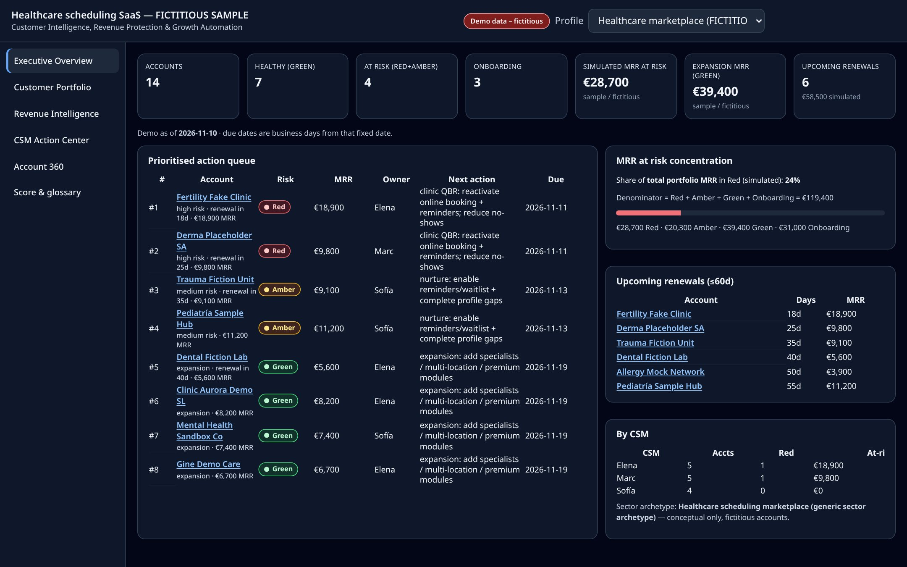</a>
</p>

<p align="center">
  <a href="https://gracianb.github.io/customer-health-intelligence/"><strong>Live demo ↗</strong></a>
  &nbsp;·&nbsp; <a href="#open-the-demo-locally">Run locally</a>
  &nbsp;·&nbsp; <a href="LICENSE">MIT</a>
</p>

<p align="center">
  
  
  
  <a href="https://gracianb.github.io/customer-health-intelligence/"></a>
</p>

Configurable Customer Success / RevOps health scoring that turns product and support signals into **Health Score · Risk Level · Reason · Recommended Action**, a prioritised queue, a revenue lens, and a static **Command Center**.

Sector profiles are **generic, conceptual archetypes** — a healthcare marketplace, a real-estate brokerage and a dynamic pricing SaaS — populated with **fictitious** accounts. They do not represent any real company.

> **Honesty first.** Scoring is **rules-based, not machine learning**, and is **not calibrated** on real churn. Money figures are **simulated SAMPLE/FICTITIOUS** amounts. Slack remains **NoOp (pending configuration)**.

---

## Live demo

**[Open the Command Center ↗](https://gracianb.github.io/customer-health-intelligence/)** — also `?profile=healthcare`, `?profile=realestate` or `?profile=pricing-saas`.

No account, no backend, no internet APIs: the demo data is embedded in JavaScript and works on GitHub Pages or by opening `START-HERE.html` locally (`file://` safe).

Profiles in the switcher:

| Profile | What it demonstrates |
| --- | --- |
| **Healthcare marketplace** — clinic scheduling | Retention and expansion from operational clinic signals |
| **Real-estate brokerage** — agency CRM | **CS Team Lead** workload, renewals and interventions |
| **Dynamic pricing SaaS** — short-term rentals | **Adoption → Value → Retention**, product vs commercial metrics |
| Generic B2B (base) | Original 10-account regression sample |

---

## The problem

Churn risk and expansion opportunity hide across login, adoption, tickets, satisfaction, onboarding and renewals. Teams need an **inspectable** score and a prioritised action queue — without a black-box model they cannot defend in a QBR.

## The solution

A single **rules engine** (`engine/healthEngine.js`) + profile configs + fictitious datasets + a static Command Center (and an optional n8n workflow for the lab).

### Eight business questions it answers

1. Which customers have the highest churn risk?
2. How much recurring revenue is exposed *(simulated)*?
3. Who needs intervention now?
4. Where is expansion potential?
5. What should each CSM prioritise?
6. Which signals explain the change?
7. Is portfolio health improving or worsening *(simulated weeks)*?
8. What results could we measure after intervening *(simulated log)*?

## Architecture

```
profiles/*  →  engine/healthEngine.js  →  Command Center (embedded data)
                     ↘ optional n8n workflow (base Profile Config)
```

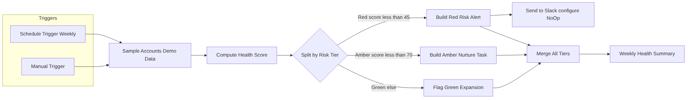

- **Explainable:** every account → score + risk + reason + recommended action + top drivers.
- **Onboarding grace:** tenure below threshold → score withheld (not unfair Red).
- **at_risk_mrr:** **Red MRR only** (Amber is a watchlist).
- In-app **Score & glossary** view documents weights, thresholds and limitations.

## Engine and configuration

| Signal (base) | Weight |
| --- | --- |
| Login recency | 25 |
| Adoption | 25 |
| Open tickets | 20 |
| NPS / satisfaction proxy | 20 |
| Onboarding complete | 10 |

Thresholds: **Red &lt; 45**, **Amber &lt; 70**, otherwise Green. Queue rank ≈ MRR × risk weight × renewal urgency. The UI shows **#rank** plus a short reason; the raw priority integer stays in a tooltip.

## Sector cases (conceptual)

<p>
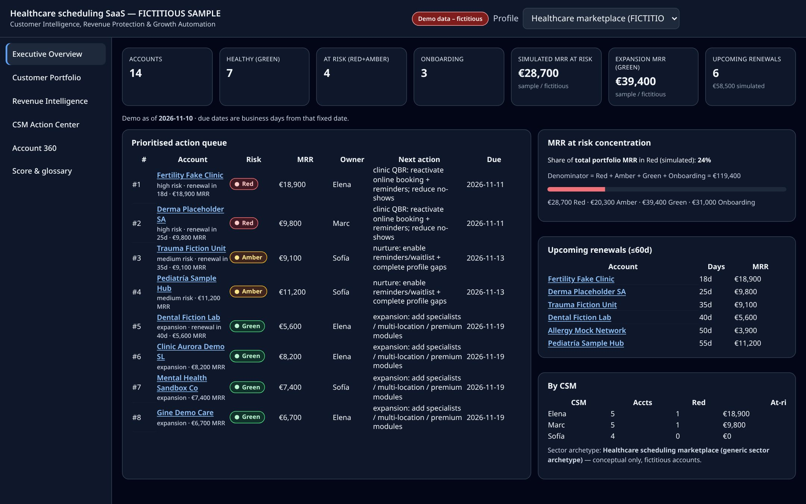
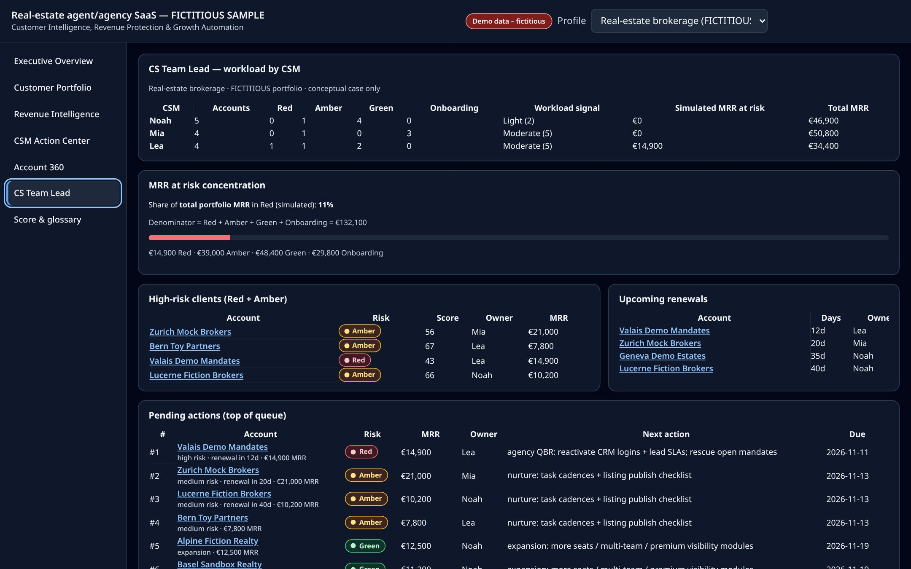
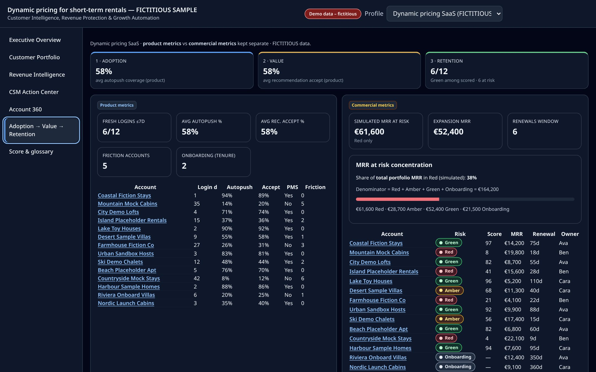
</p>


## Command Center tour

All screenshots are captured from the real rendered demo (`scripts/capture-docs-screenshots.cjs`) and show **fictitious sample accounts only**.

| Customer Portfolio | Revenue Intelligence |
| --- | --- |
| 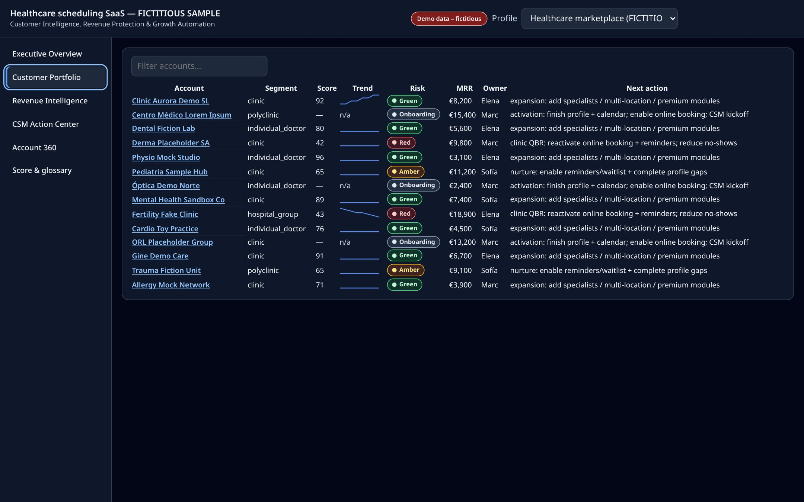 | 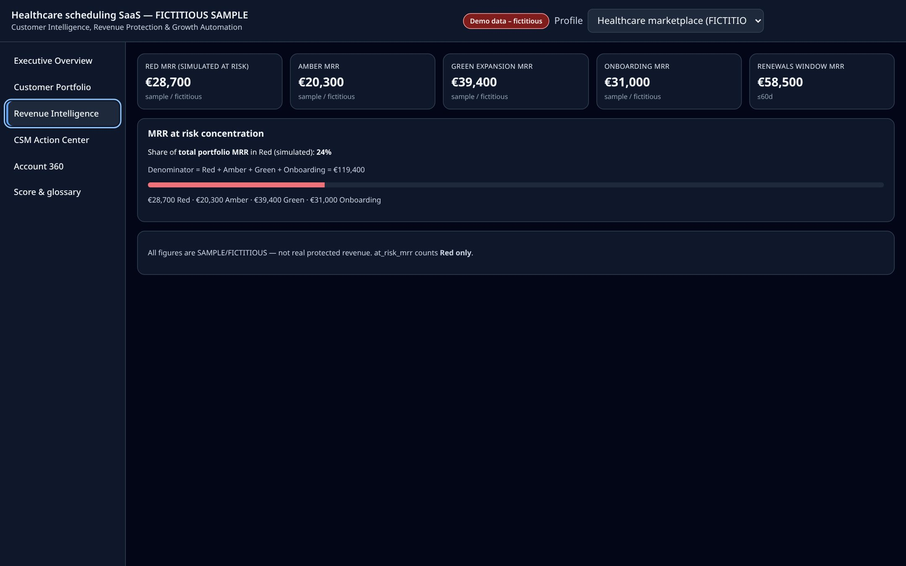 |
| **CSM Action Center** | **Account 360** |
| 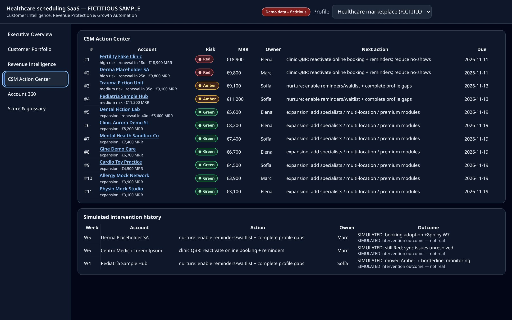 | 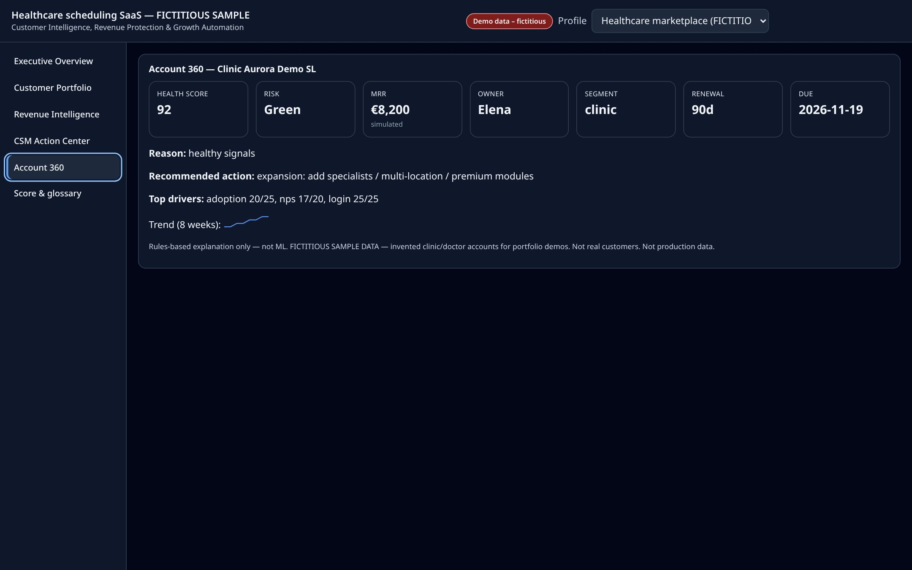 |
| **Score & glossary** | **Mobile (390 px)** |
| 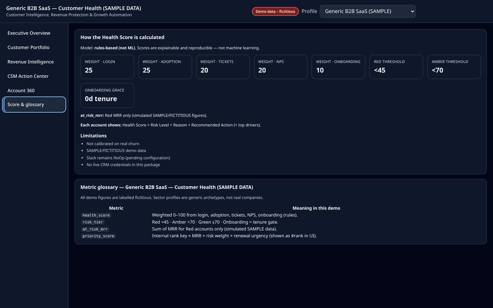 | 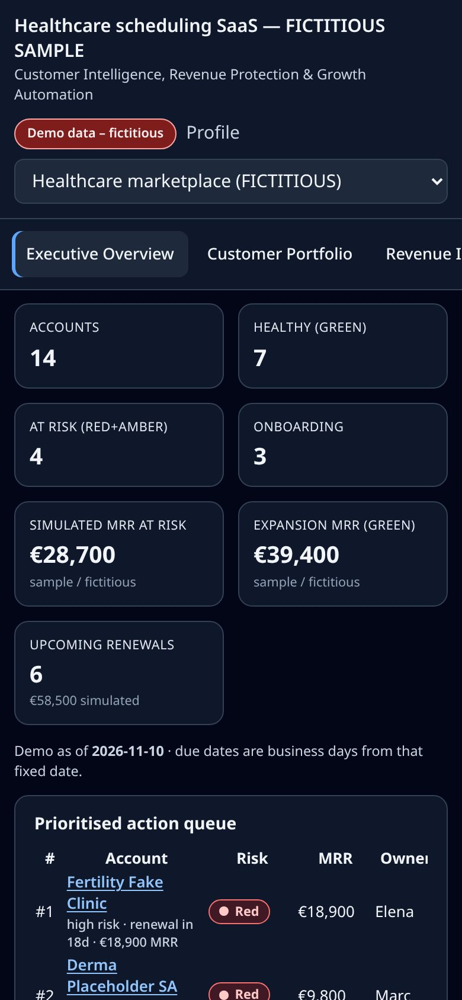 |

Full gallery: [`docs/screenshots/`](./docs/screenshots/README.md).

## Open the demo locally

1. Download or clone this repository.
2. Double-click **`START-HERE.html`** (or `command-center/index.html`).
3. No server, Docker, Node or internet is required.

To preview the same way GitHub Pages does:

```bash
python3 -m http.server 8080
# then open http://127.0.0.1:8080/
```

Optional n8n lab: `docker compose up` binds **127.0.0.1:5678** with pinned `n8nio/n8n:2.46.7`. Slack stays **NoOp**.

## Tests

```bash
npm test
npm run test:summary   # executed / passed / failed / skipped (TAP + skip reasons)
npm run check:links
```

Visual / `file://` / local-http checks need Chrome or Chromium (portable detection via `CHROME_PATH`, Playwright, or common install paths). If no browser is found, those tests **skip with an explicit reason** — unit, engine, drift and link tests still run.

Do not advertise a single fixed total; use `npm run test:summary` on your machine.

## Limitations

- Rules-based, **not ML**, **not calibrated** on real churn.
- SAMPLE / FICTITIOUS data only.
- Slack **NoOp**.
- Weekly history and intervention outcomes are **SIMULATED**.
- No live CRM credentials in this package.

## Roadmap (proposed)

CSV / CRM import · human-approved Slack routing · threshold calibration · optional statistical model **only** after holdout validation.

## Portfolio fit

**Single implementation.** Other portfolio properties should [link here](https://github.com/GracianB/customer-health-intelligence), not fork the engine. See [`docs/portfolio-fit.md`](./docs/portfolio-fit.md).

## License

MIT — [`LICENSE`](./LICENSE). Public demo only.

**Español:** [`docs/es/README.es.md`](./docs/es/README.es.md) · Status: [`docs/STATUS.md`](./docs/STATUS.md) · Pages: [`docs/PAGES.md`](./docs/PAGES.md) · Known issues: [`docs/known-issues.md`](./docs/known-issues.md)

---

Screenshots in this repository are a **curated, compressed set** (`docs/assets/`, `docs/screenshots/`). The full hi-res `screenshots/final/` pack and the demo video ship only in release zips, not in git, to keep the clone small.
