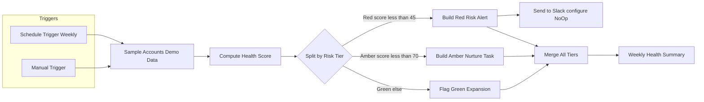

# Architecture

Rules-based Customer Health scoring automation in n8n (not machine learning).

## Diagram

Source: [`diagrams/architecture.mmd`](./diagrams/architecture.mmd)

SVG: [`diagrams/architecture.svg`](./diagrams/architecture.svg)

## Robust summary (v1.1.0)

`Weekly Health Summary` reads the three builder nodes by name (`$('…').all()`), so totals do not depend on Merge timing. See [`findings.md`](./findings.md).

## Data contract (SAMPLE)

Each demo account: `account`, `mrr`, `last_login_days`, `active_users_pct`, `open_tickets`, `nps`, `onboarding_completed`, `csm`, `data_source`.

After scoring: `health_score`, `risk_tier`, `reason`, `playbook`, `scored_at`.

## Summary contract

`at_risk_mrr` = Σ `mrr` where tier is Red (Amber excluded) — **simulated MRR at risk (sample data)**.

## Trust boundaries

| Asset | Public package | Private only |
| --- | --- | --- |
| Scrubbed workflow JSON | Yes | — |
| SAMPLE DATA | Yes (labelled) | — |
| Screenshots | Yes | — |
| n8n credentials / cookies / DB | Never | Author machine |
| Slack / CRM secrets | Never | When you configure delivery |
