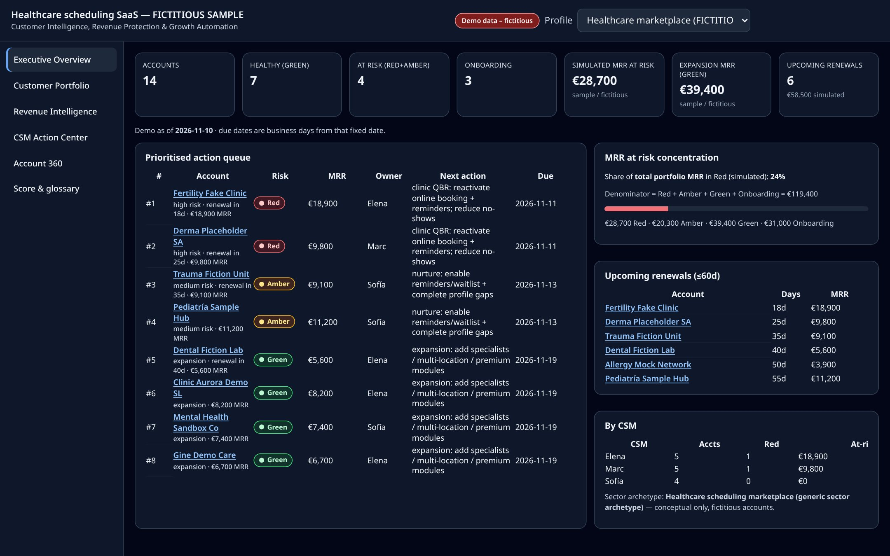
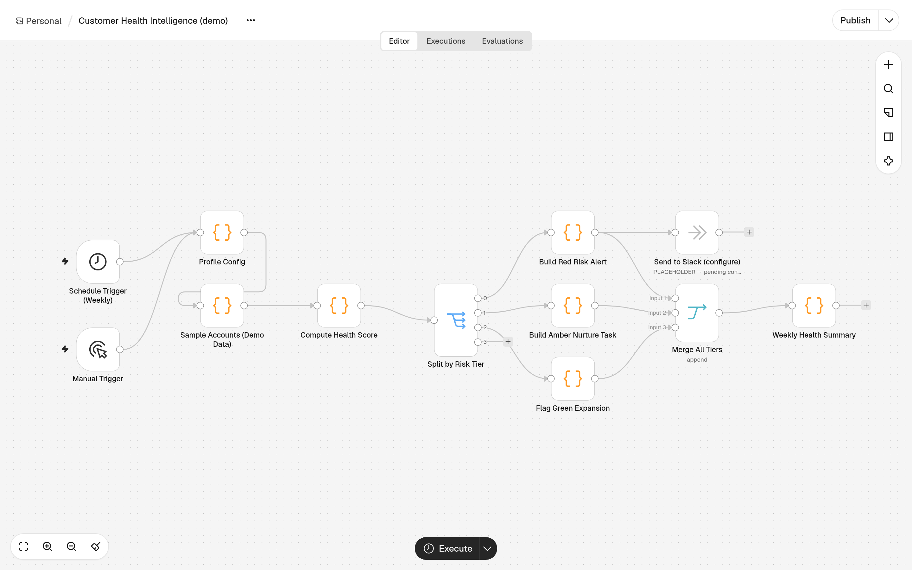
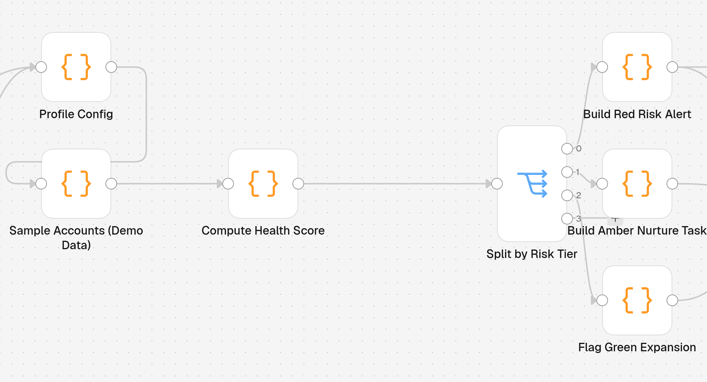
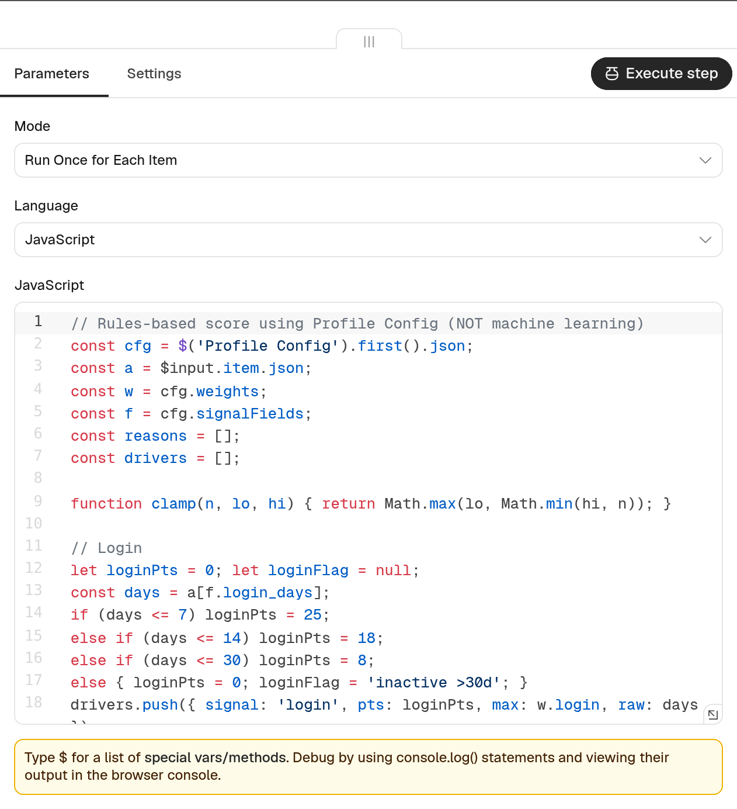

# Customer Health Intelligence

### Customer Intelligence, Revenue Protection & Growth Automation

**Demo CS / RevOps basada en reglas · datos SAMPLE / FICTICIOS · MIT · v1.2.2**

## Abrir la demo (Windows — sin instalación)

1. Descomprime el ZIP.
2. **Doble clic en `START-HERE.html`** (o `command-center/index.html`).
3. No hace falta servidor, Docker, Node ni Internet — datos **embebidos** (compatible con `file://`).

Guía rápida: [`../../START-HERE.txt`](../../START-HERE.txt).

## Qué resuelve

Convierte señales de producto y soporte en **Health Score · Nivel de riesgo · Motivo · Acción recomendada**, cola priorizada, lente de ingresos y Command Center estático.

**No es machine learning.** Los perfiles sectoriales son **arquetipos genéricos** con cuentas ficticias — no representan a ninguna empresa real.

## Tres perfiles

- **Healthcare marketplace** — marketplace sanitario: retención/expansión en agenda de clínicas.
- **Inmobiliaria (brokerage)** — vista **CS Team Lead**.
- **SaaS de precios dinámicos** — **Adoption → Value → Retention** (métricas de producto vs comerciales).

## Cómo se calcula el score

Pesos configurables (login / adopción / tickets / NPS / onboarding), umbrales Rojo &lt;45 / Ámbar &lt;70, gracia de onboarding por antigüedad. Explicación in-app: vista **Score & glossary**. `at_risk_mrr` = solo MRR Rojo (simulado).

## Workflow de n8n

Capturas reales del workflow importable ([`../../workflows/customer-health-intelligence.json`](../../workflows/customer-health-intelligence.json)), abierto en n8n **inactivo** (sin ejecutar). El nodo de Slack es un **NoOp**, pendiente de configuración: no se envía nada.

| Lienzo completo | Sección de scoring |
| --- | --- |
|  |  |

Nodo **Compute Health Score** — Parameters / JavaScript (basado en reglas, no es ML). Solo se muestra la configuración, sin datos de ejecución:

## Limitaciones

No calibrado · datos ficticios · Slack NoOp · semanas/intervenciones SIMULADAS · sin credenciales CRM en el paquete.

## Licencia

MIT. Demo pública.
