# Command Center — screenshot gallery

Captured from the real rendered Command Center with `scripts/capture-docs-screenshots.cjs` (headless Chromium, 1440×900 unless noted).
**All accounts, owners and money figures are fictitious sample data.** Sector profiles are generic archetypes, not real companies.

## Executive overview — one per profile

| Profile | Screenshot |
| --- | --- |
| Healthcare marketplace | 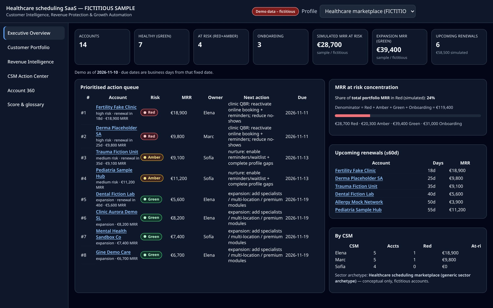 |
| Real-estate brokerage | 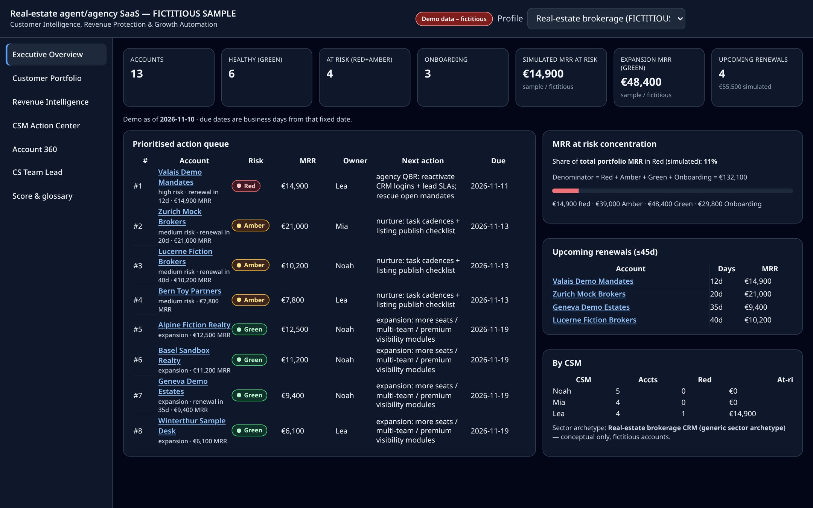 |
| Dynamic pricing SaaS | 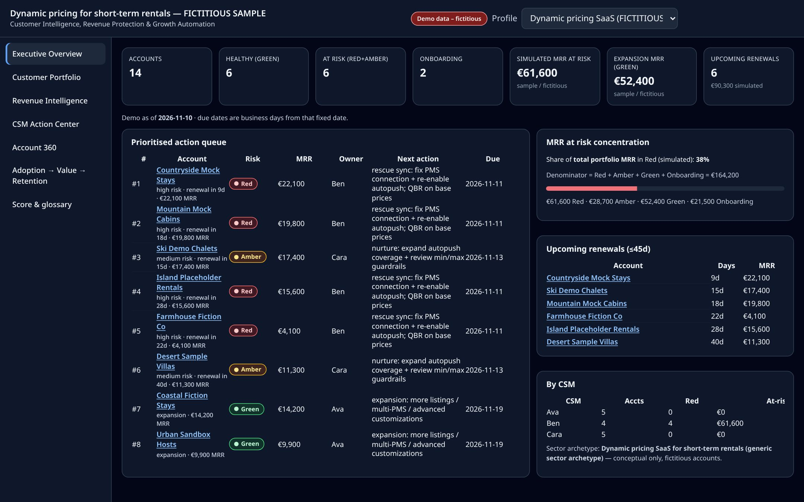 |
| Generic B2B (base) | 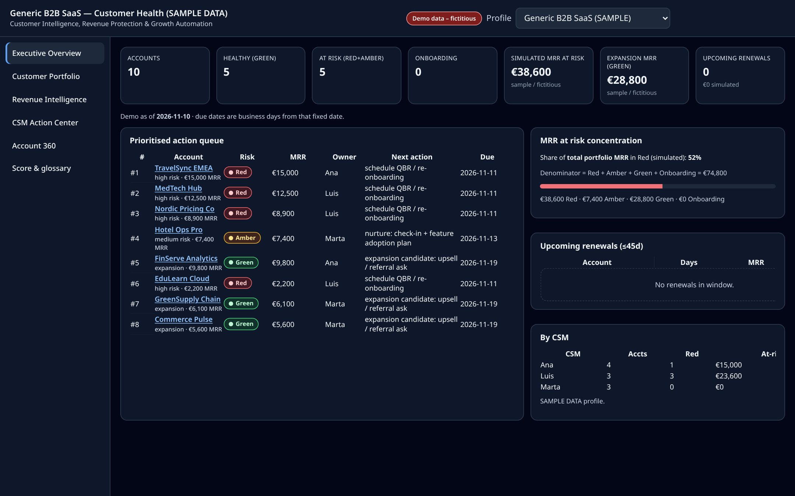 |

## Views

| View | Screenshot |
| --- | --- |
| Customer Portfolio | 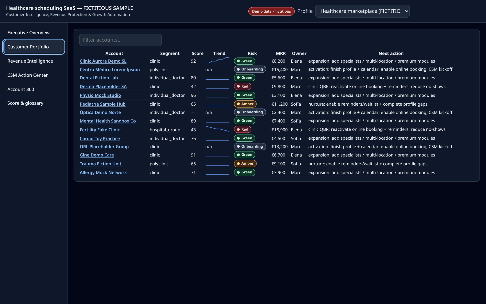 |
| Revenue Intelligence | 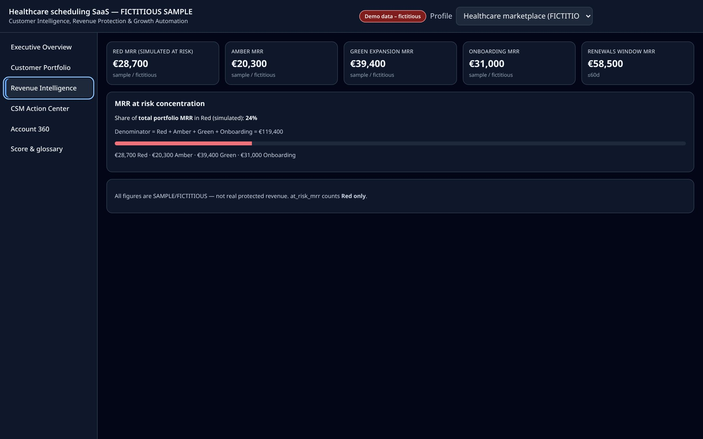 |
| CSM Action Center | 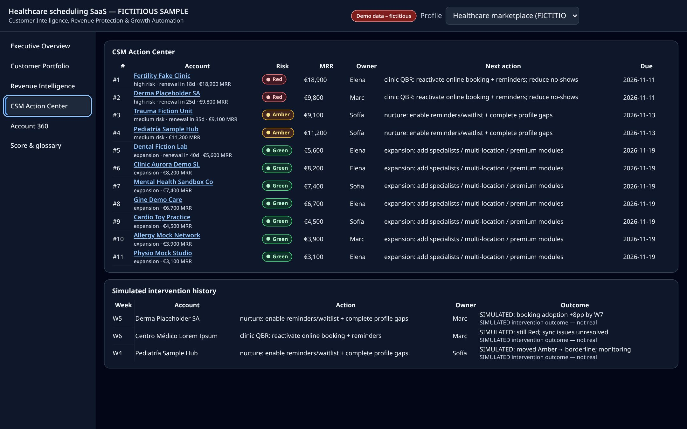 |
| Account 360 | 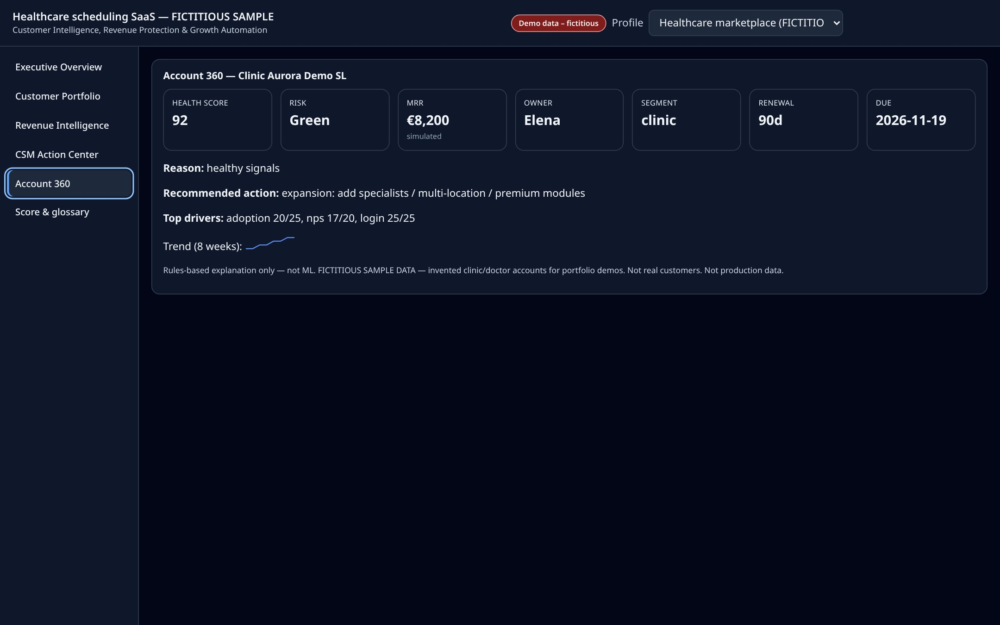 |
| CS Team Lead (real-estate brokerage) | 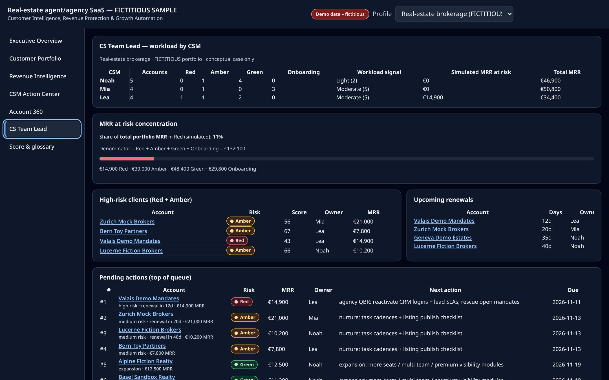 |
| Adoption → Value → Retention (dynamic pricing SaaS) | 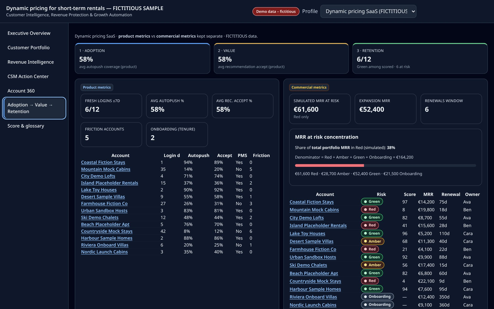 |
| Score & glossary | 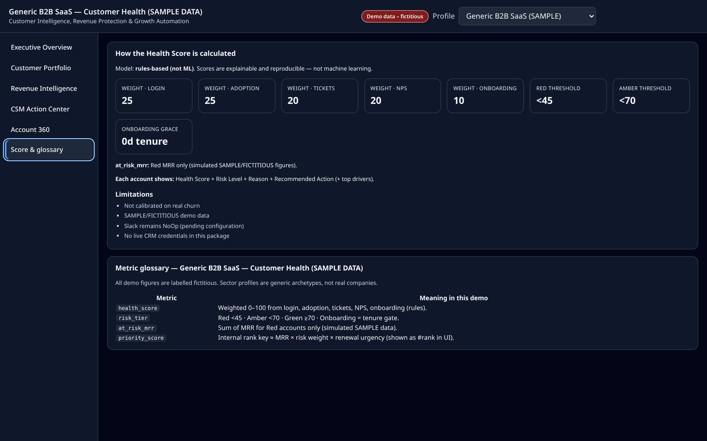 |
| Mobile overview (390 px) | 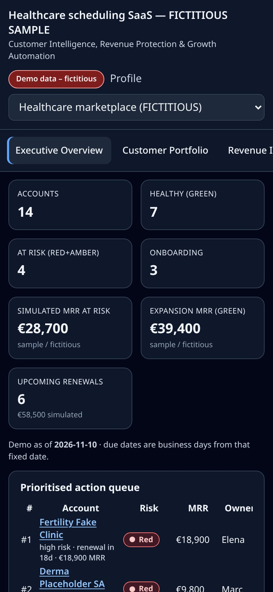 |

Regenerate: `CHROME_PATH=/path/to/chrome node scripts/capture-docs-screenshots.cjs`

## n8n workflow

Captured from the **importable** workflow (`workflows/customer-health-intelligence.json`) opened in n8n **inactive** (not executed). The Slack node is a **NoOp**, pending configuration. No execution output is shown.

| Shot | File |
| --- | --- |
| Full canvas, fit to view (1440×900) | 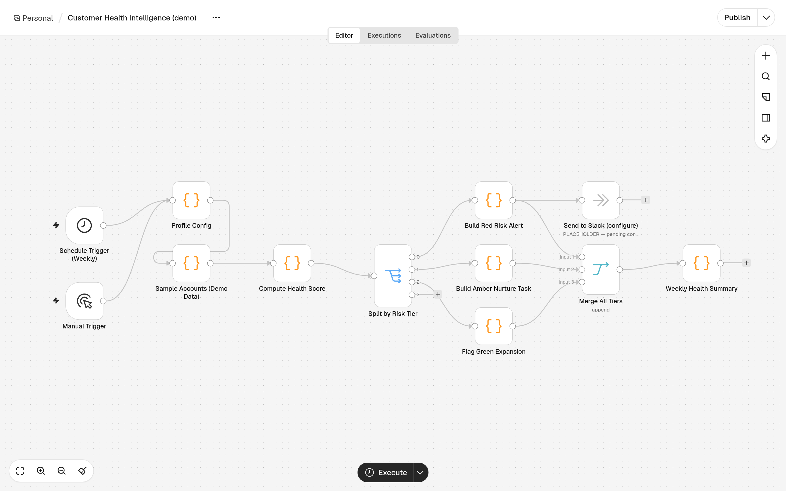 |
| Zoomed scoring and routing section | 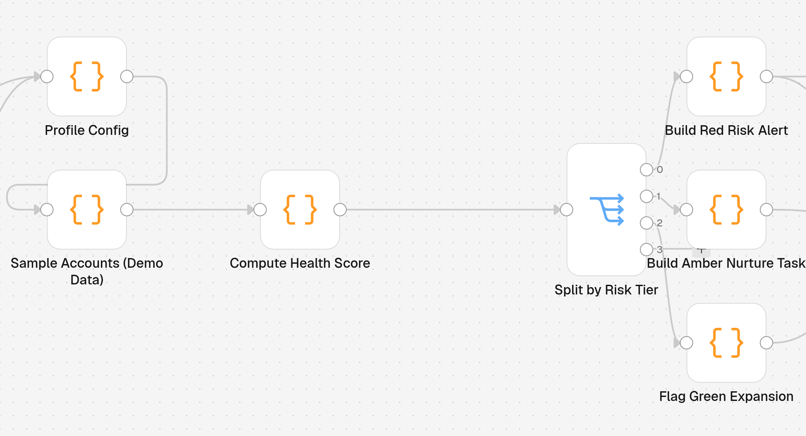 |
| Compute Health Score — Parameters / JavaScript | 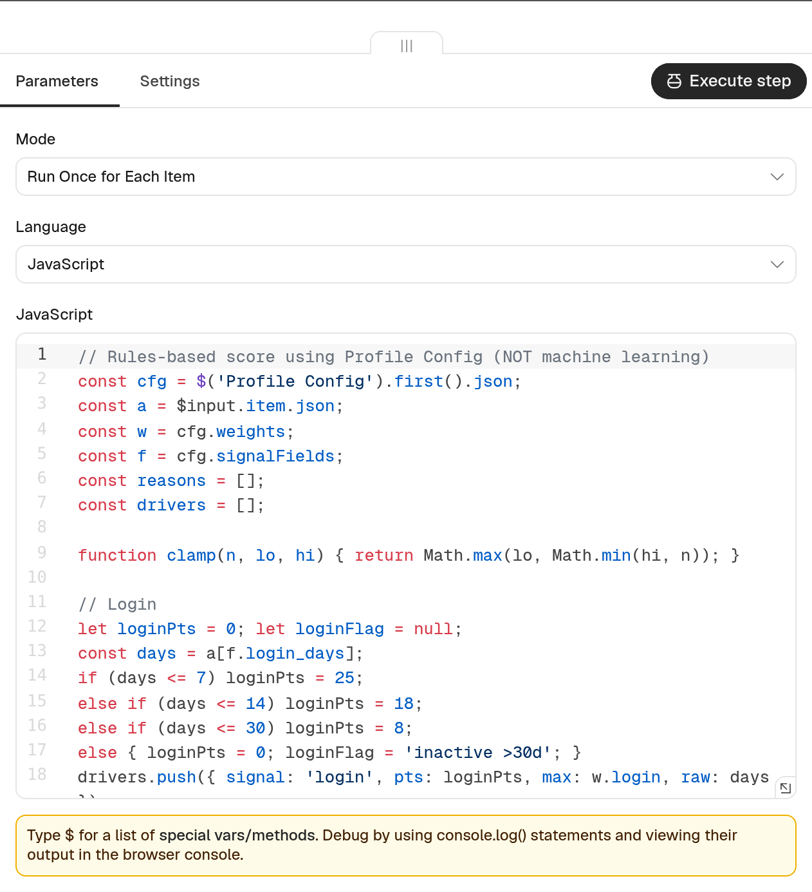 |
